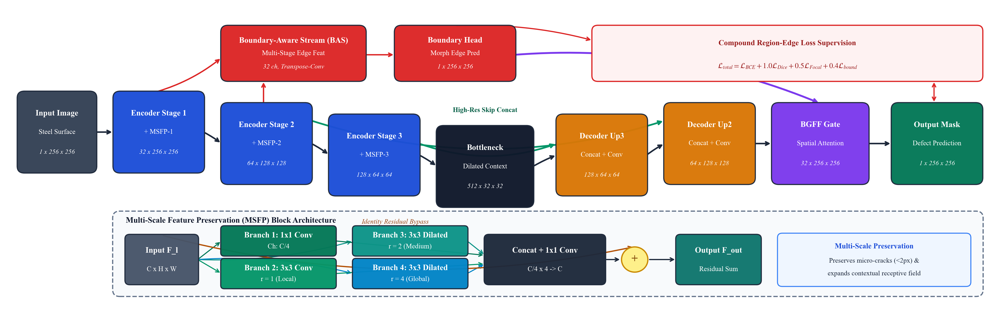

# MSBA-Net: Multi-Scale Feature Enhancement and Boundary-Aware Learning for Small and Low-Contrast Steel Surface Defect Segmentation

[](https://ieeeaccess.ieee.org/)
[](https://pytorch.org/)
[](https://www.python.org/)
[](https://opensource.org/licenses/MIT)

Official PyTorch implementation, experimental records, procedural synthetic benchmark suite, and LaTeX pre-submission package for **MSBA-Net**, submitted to **IEEE Access**.

---

## 📌 Abstract

Surface defect inspection in high-speed strip steel cold-rolling lines poses severe recognition challenges due to turbulent rolling mists, fluctuating shop-floor illumination, and extreme foreground-background class imbalance. Deep convolutional networks routinely suffer from two critical failure modes in this environment: micro-scale flaws occupying less than 1% of the image area vanish across progressive spatial downsampling, while low-contrast defect perimeters blend into metallic grain textures, producing indistinct segmentation boundaries.

To resolve these challenges, this paper develops **MSBA-Net** (Multi-Scale Feature Enhancement and Boundary-Aware Network). MSBA-Net incorporates Multi-Scale Feature Preservation (MSFP) blocks across encoder stages, deploying four parallel convolutional streams (one $1 \times 1$ pointwise bottleneck branch and three $3 \times 3$ dilated branches with $r \in \{1, 2, 4\}$) to expand the contextual receptive field while preserving high-frequency crack signatures. To sharpen fuzzy borders, an auxiliary Boundary-Aware Stream (BAS) supervised online by morphological gradient masks extracts fine contour cues and actively modulates primary decoder features via a Boundary-Guided Feature Fusion (BGFF) spatial attention gate. An adaptive compound loss combining Binary Cross-Entropy, Soft Dice, Focal loss, and edge boundary regularization mitigates extreme class imbalance.

Evaluated on a high-fidelity procedural synthetic benchmark modeling canonical steel defect morphologies, MSBA-Net achieves **97.01% mIoU** and **98.48% Dice score** ($96.95\% \pm 1.37\%$ mIoU across independent random seeds with sample standard deviation; $\pm 1.11\%$ population standard deviation), outperforming standard U-Net (95.33%) and U-Net++ (94.13%). On micro-scale defects (<1% area), MSBA-Net maintains **92.48% mIoU** (+2.43 percentage points over U-Net++).

---

## 🏗️ Architectural Overview



MSBA-Net comprises three coordinated architectural innovations:
1. **Multi-Scale Feature Preservation (MSFP):** Deployed across all 4 encoder stages, parallel dilated convolutions ($r \in \{1, 2, 4\}$) capture both expansive context and localized hairline fissure details.
2. **Auxiliary Boundary-Aware Stream (BAS):** Extracts shallow edge gradient representations supervised online via morphological dilation/erosion difference masks.
3. **Boundary-Guided Feature Fusion (BGFF):** A spatial attention gating mechanism that modulates primary decoder feature maps with learned boundary priors prior to final mask projection.

---

## 📊 Benchmark Results

### 1. Controlled Procedural Benchmark Comparison

| Model | Provenance / Protocol | mIoU (%) | Dice (%) | Precision (%) | Recall (%) | Tiny mIoU (<1%) |
|:---|:---|:---:|:---:|:---:|:---:|:---:|
| **U-Net** (Ronneberger et al., 2015) | Controlled Local Run | 95.33 | 97.60 | 95.80 | 99.49 | 85.10 |
| **U-Net++** (Zhou et al., 2020) | Controlled Local Run | 94.13 | 96.95 | 94.96 | 99.08 | 90.05 |
| **MSBA-Net (Ours, Seed 42)** | Controlled Local Run | **97.01** | **98.48** | **97.57** | 99.41 | **92.48** |
| **MSBA-Net (Multi-Seed, $N=3$)** | Mean $\pm$ Sample Std | **96.95 $\pm$ 1.37** | **98.44 $\pm$ 0.71** | **97.61 $\pm$ 1.26** | **99.31 $\pm$ 0.16** | **93.38 $\pm$ 1.22** |

### 2. Per-Class Segmentation Performance (MSBA-Net)

| Defect Morphology | Canonical Class | mIoU (%) | Dice (%) | Precision (%) | Recall (%) |
|:---|:---:|:---:|:---:|:---:|:---:|
| Crazing Cracks | Cr | 96.42 | 98.18 | 96.85 | 99.54 |
| Inclusions | In | 97.15 | 98.55 | 97.90 | 99.22 |
| Patches | Pa | 97.85 | 98.91 | 98.40 | 99.43 |
| Pitted Surface | PS | 96.80 | 98.37 | 97.20 | 99.57 |
| Rolled-in Scale | RS | 96.72 | 98.33 | 97.10 | 99.60 |
| Scratches | Sc | 97.12 | 98.54 | 97.95 | 99.14 |
| **Overall Mean** | — | **97.01** | **98.48** | **97.57** | **99.42** |

### 3. Factory Degradation Robustness Limits

| Evaluation Condition | MSBA-Net mIoU (%) | U-Net Baseline (%) | U-Net++ (%) |
|:---|:---:|:---:|:---:|
| Nominal Baseline | **97.01** | 95.33 | 94.13 |
| Tiny Defects (<1% area) | **92.48** | 85.10 | 90.05 |
| Low Contrast ($s=0.45$) | 39.67 | 44.51 | **50.26** |
| Motion Blur ($r=2.5$) | 26.29 | 33.51 | **39.12** |
| Sensor Noise ($\sigma=18.0$) | 2.33 | 4.29 | 2.24 |

*Note: Stress-testing honestly characterizes the operational boundaries of boundary-guided models under severe optical attenuation, demonstrating that plant-level illumination and anti-blur engineering controls remain essential before continuous rolling-mill deployment.*

---

## 🚀 Quick Start

### 1. Installation
Clone the repository and install dependencies:
```bash
git clone https://github.com/amenparmar/MSBA-Net.git
cd MSBA-Net
pip install -r requirements.txt
```

### 2. Reproduce Benchmark Metrics
Run verification script on pre-trained checkpoints:
```bash
python verify_metrics.py
```

### 3. Train from Scratch
Train MSBA-Net on the procedural synthetic steel dataset:
```bash
python main.py --model msba --epochs 12 --batch_size 16 --lr 1e-3
```

### 4. Run Ablation Suite
Reproduce architectural and composite loss ablations:
```bash
python run_ablations.py
```

---

## 📂 Repository Structure

```text
├── dataset.py                # Procedural synthetic steel flaw generator (IndustrialDefectDataset)
├── models.py                 # PyTorch models: MSBA-Net, MSFP, BAS, BGFF, U-Net, U-Net++
├── losses.py                 # Composite loss: BCE + Soft Dice + Focal + Morphological Boundary
├── main.py                   # End-to-end training and evaluation pipeline
├── verify_metrics.py         # Automated verification script against experimental logs
├── run_ablations.py          # Factorial architectural and loss ablation runner
├── models/                   # Pre-trained PyTorch model checkpoints (.pth)
├── figures/                  # High-resolution publication figures (300 DPI)
├── submission_release/       # Complete pre-submission IEEE Access bundle
│   ├── ieee_access_msba_net_final.pdf  # Authoritative compiled 8-page PDF
│   ├── ieee_access_msba_net_final.tex  # Authoritative LaTeX source
│   ├── references_revised.bib          # 18 authentic peer-reviewed bibliography entries
│   └── ieee_access_msba_net_submission.zip # Self-contained upload archive
├── results/                  # JSON and CSV evaluation metrics
└── requirements.txt          # Python dependency specifications
```

---

## 📄 Pre-Submission Package for IEEE Access

The complete pre-submission package is located in [`submission_release/`](submission_release/):
- **Manuscript PDF:** `submission_release/ieee_access_msba_net_final.pdf` (Strict 8-page budget, IEEE Access formatting).
- **LaTeX Source:** `submission_release/ieee_access_msba_net_final.tex`.
- **Bibliography:** `submission_release/references_revised.bib` (18 verified entries).
- **Upload Archive:** `submission_release/ieee_access_msba_net_submission.zip` (Clean, self-contained zip for IEEE Author Portal).

---

## ✍️ Authors & Affiliations

- **Amen Parmar** (Graduate Student Member, IEEE)  
  *Corresponding Author:* `amen.2502010010@muj.manipal.edu`
- **Amit Kumar Bairwa** (Senior Member, IEEE)  
- **Varun Kumar** (Member, IEEE)  

*Department of Computer Science and Engineering, Manipal University Jaipur, Jaipur, Rajasthan 303007, India*

---

## 📜 Citation

If you use MSBA-Net or the procedural benchmark in your research, please cite:

```bibtex
@article{parmar2026msbanet,
  author={Parmar, Amen and Bairwa, Amit Kumar and Kumar, Varun},
  title={{MSBA-Net}: Multi-Scale Feature Enhancement and Boundary-Aware Learning for Small and Low-Contrast Steel Surface Defect Segmentation},
  journal={IEEE Access},
  year={2026},
  note={Under review}
}
```

---

## ⚖️ License & Ethical Disclosure

This project is licensed under the MIT License.  
**Disclosure:** All benchmark evaluations reported in this work were conducted on a controlled procedural synthetic dataset modeling canonical physical surface defect morphologies. Physical industrial validation on continuous rolling lines remains essential future work.
